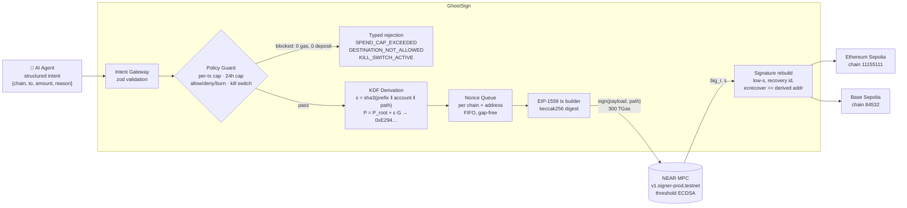

# 👻 GhostSign

### Universal Keyless Execution Layer for AI Agents via NEAR Chain Signatures (MPC)

> An AI agent controls wallets on Ethereum, Base, and any other EVM chain **without a single private key existing anywhere**. Every transaction is signed by the NEAR MPC network, under policy guardrails the agent cannot bypass.

**NEAR Global Hackathon** · Tracks: **AI Agent Economy** · **Chain Abstraction**

---

## The problem

Autonomous agents are starting to hold money. The default way to give an agent a multi-chain wallet is to hand it a private key per chain, and that is a security disaster:

- **A single prompt injection can drain everything.** If the key is on the agent's machine, anything that can talk the agent into running code or leaking memory takes the key, and with it the funds on every chain that key controls.
- **N chains means N secrets to generate, store, rotate, and back up.** Each one is a separate thing that can leak through logs, `.env` files, crash dumps, or a compromised dependency.
- **Keys are all or nothing.** A raw private key has no spending limit, no allowlist, and no off switch. Once an agent decides to send funds, nothing structural stops it.
- **Agents misbehave in new ways.** Hallucinated amounts, injected destination addresses, and retry loops that double-send are routine failure modes for LLM agents, not edge cases.

## The solution

GhostSign removes the keys entirely.

1. The agent's identity is one **NEAR account**. Its foreign addresses are **derived deterministically** from that account plus a path (`ethereum-1`, `ethereum-2`, …) using the NEAR Chain Signatures key derivation function.
2. When the agent wants to act, it submits a structured **intent**: chain, destination, amount, and a reason.
3. A **policy guard** checks the intent (per-tx cap, rolling 24h cap, destination rules, kill switch) **before** anything is signed. A rejected intent costs no gas and produces no signature.
4. A **nonce queue** serialises signing per chain and address, so concurrent intents never collide.
5. The transaction hash goes to the **NEAR MPC contract** (`v1.signer-prod.testnet`). The MPC nodes jointly produce an ECDSA signature for the derived key. **No node, and no part of GhostSign, ever holds that key.**
6. GhostSign rebuilds and verifies the `(r, s, v)` signature (with EIP-2 low-s normalisation and an ecrecover check), then broadcasts the transaction to the target chain.

The same NEAR account and path give the **same address on every EVM chain**. Replay protection comes from the EIP-155 chain ID inside the signed hash.

## Architecture



<details>
<summary>ASCII version</summary>

```
 Agent Intent ──► Intent Gateway ──► Policy Guard ──✗──► typed rejection (no gas, no signature)
 {chain,to,          (zod)          caps · lists · kill
  amount,reason}                          │ ✓
                                          ▼
                              KDF: NEAR account + path ──► 0xE2949d91…d212 (same on all EVM chains)
                                          │
                                          ▼
                              Nonce Queue (per chain/address)
                                          │
                                          ▼
                              EIP-1559 tx ──keccak256──► NEAR MPC  v1.signer-prod.testnet
                                                              │  (threshold ECDSA, no key anywhere)
                                                              ▼
                              (r, s, v) rebuild + ecrecover check
                                          │
                         ┌────────────────┴────────────────┐
                         ▼                                 ▼
                 Ethereum Sepolia (11155111)        Base Sepolia (84532)
```
</details>

| Module | Responsibility |
|---|---|
| [`src/crypto/kdf.ts`](src/crypto/kdf.ts) | Chain Signatures key derivation (`ε`, child public key, EVM address). Matches the contract's `derived_public_key` exactly. |
| [`src/services/mpcSigner.ts`](src/services/mpcSigner.ts) | NEAR MPC client: `sign` with 300 TGas, keeps polling across the yield/resume timeout so a paid signature is never lost. |
| [`src/chains/evmSignature.ts`](src/chains/evmSignature.ts) | Turns MPC `(big_r, s)` into Ethereum `(r, s, yParity)`, handling `s > n/2` and proving the result recovers to the derived address. |
| [`src/chains/evmExecutor.ts`](src/chains/evmExecutor.ts) | Multi-chain EVM executor: chain-ID check, fee and gas estimation, worst-case balance check (including the Base L1 data fee), broadcast, confirmation. |
| [`src/services/nonceManager.ts`](src/services/nonceManager.ts) | Per-(chain, address) FIFO queue. Uses `max(pending, local)` and never leaves a nonce gap on failure. |
| [`src/policy/guard.ts`](src/policy/guard.ts) | Policy engine: atomic spend reservations, rolling 24h window, burn/deny/allow lists, kill switch. |
| [`src/agent/intentGateway.ts`](src/agent/intentGateway.ts) | Single agent entry point. Typed `{success, txHash, explorerUrl, chain, executionTimeMs}` results and progress stages. Exports a JSON Schema for LLM tool calling. |
| [`src/server/`](src/server) + [`dashboard/`](dashboard) | Local API (SSE) and the React command-center dashboard. |

## ✅ Verified on-chain proofs

Every transaction below was signed by the **NEAR MPC network**. No Ethereum or Base private key was ever created. Each one is sent from the MPC-derived address of NEAR account [`ghostsign-mw3bniwz.testnet`](https://testnet.nearblocks.io/address/ghostsign-mw3bniwz.testnet) at path `ethereum-1`:

**Agent address (same on both chains): [`0xE2949d91b0db27636f20FBD79217cB3f5325d212`](https://sepolia.etherscan.io/address/0xE2949d91b0db27636f20FBD79217cB3f5325d212)**

| # | Chain | Nonce | Block | EVM transaction | NEAR MPC `sign` tx | What it proves |
|---|---|---|---|---|---|---|
| 1 | Ethereum Sepolia | 0 | 12068534 | [0x1710b3ae…cd13](https://sepolia.etherscan.io/tx/0x1710b3ae7c9e8932134d86a8bae3cef35c81942e67e8dc07ddf69a5121a6cd13) | [BBQy2MAf…](https://testnet.nearblocks.io/txns/BBQy2MAfjyTHUXFNJyVxfeznTpZ9rhC6Mdxqvh9V6zbh) | First keyless MPC-signed transfer |
| 2 | Ethereum Sepolia | 1 | 12068755 | [0x132b61c3…e5fd](https://sepolia.etherscan.io/tx/0x132b61c3b7ff71e3d8819c9a8e97dc2184ffef811afefebdd3a95df856a1e5fd) | [DFNzHtr2…](https://testnet.nearblocks.io/txns/DFNzHtr21UppAVq6k6bAZF3UgAF5m3fgP6nBSxviQNgv) | Intent gateway + policy pass |
| 3 | Ethereum Sepolia | 2 | 12068757 | [0xfe2b5509…5f84](https://sepolia.etherscan.io/tx/0xfe2b5509800b7cc9071fe6af4b1ae9c8b87d8d1c6d003ffa0c1cc713e8945f84) | [J5zQXfwq…](https://testnet.nearblocks.io/txns/J5zQXfwq1LBqGHgs4CMUPFz5LUVUtfYpdHTEFuDz35JM) | Concurrent intent #1, nonce queue |
| 4 | Ethereum Sepolia | 3 | 12068760 | [0x057de6fa…2e18](https://sepolia.etherscan.io/tx/0x057de6fa382f66cea999f3864c3587e0cf75c0ee71b8d0d3bc5f5bfb1f012e18) | [7CdaSTow…](https://testnet.nearblocks.io/txns/7CdaSTowdUtd14zubkjb4KE4kw43QFkUsUBjzZCKsum7) | Concurrent intent #2, no nonce collision |
| 5 | Ethereum Sepolia | 4 | 12068773 | [0x1f844c38…74d8](https://sepolia.etherscan.io/tx/0x1f844c3805edbc579142bc15a2a16a4dd5dfa9723d3d19d14298189824b274d8) | [G8UkmnJC…](https://testnet.nearblocks.io/txns/G8UkmnJCcE2MzYp8w89tQEJkLgYkrGaW2xMW7xtn6ErP) | Multi-chain run, Ethereum leg |
| 6 | **Base Sepolia** | 0 | **54756585** | [0x7b66639b…3de0](https://sepolia.basescan.org/tx/0x7b66639baf6cba0564ffecc18fbe2f5d87f4c4d1d79e0ffeaacd1cd7cfa43de0) | [h7KR9H7k…](https://testnet.nearblocks.io/txns/h7KR9H7kaHtb9B7XXDrFbuJHchB6TpTeHNMZBeQVCFy) | **Same derived address on an L2** |
| 7 | Ethereum Sepolia | 5 | 12068825 | [0x4d76d88f…1afd](https://sepolia.etherscan.io/tx/0x4d76d88fcb067e1007fe653523cec571a7690f3bbb1f8721212d29d7d6841afd) | [Hfz1yAGJ…](https://testnet.nearblocks.io/txns/Hfz1yAGJm8cVxzttr8NHBBrk6sHFBZ1whiTm9tTjufi4) | Dashboard burst, Ethereum leg |
| 8 | Base Sepolia | 1 | 54759674 | [0xc500543a…314c](https://sepolia.basescan.org/tx/0xc500543a114d2059be7b916a36664a8936f6061f5e27e08bd8bcbc80fa41314c) | [Bkd1xej6…](https://testnet.nearblocks.io/txns/Bkd1xej6SbReP9Xzepr55LQtAQDDPoawLm74XfY6j2dj) | Dashboard burst, Base leg, signed in parallel with #7 |

Funds were sent to the agent's own treasury at path `ethereum-2` ([`0x98f4b114…31f5`](https://sepolia.etherscan.io/address/0x98f4b11472dC289Ecda40CD98f2A8074918d31f5)), which is also MPC-controlled.

**Blocked before signing (no NEAR gas, no deposit, no signature produced):** an over-cap amount (`SPEND_CAP_EXCEEDED`), a transfer to `0x…dEaD` (`DESTINATION_NOT_ALLOWED`), and an intent while frozen (`KILL_SWITCH_ACTIVE`). Each was rejected in about 1 ms, live in the dashboard and in `scripts/demo-agent.ts`.

**Verify the derivation yourself:** `npm run dev -- verify ethereum-1` compares the local KDF output with the MPC contract's `public_key` and `derived_public_key` view methods.

## Quickstart

**Requirements:** Node.js ≥ 22.22, and a funded NEAR testnet account (a few NEAR covers hundreds of signatures; each `sign` costs about 0.001 NEAR in gas and the deposit is refunded).

```bash
git clone https://github.com/nehaiqoo-source/GhostSign.git && cd GhostSign
npm install
cp .env.example .env
```

Edit `.env` and set `NEAR_ACCOUNT_ID` and `NEAR_PRIVATE_KEY` (`ed25519:…`). Then:

```bash
# 1. Check your derived key against the live MPC contract
npm run dev -- verify ethereum-1

# 2. Print your agent's EVM address, then fund it with Sepolia and/or Base Sepolia ETH
npm run dev -- address ethereum-1

# 3. Run the test suite (34 tests: KDF, signatures, nonce queue, policy, gateway, multi-chain executor)
npm test

# 4. Launch the dashboard: API on :8787 + UI with hot reload on http://127.0.0.1:5173
npm run dev:all
```

Other entry points:

| Command | What it does |
|---|---|
| `npm run dashboard` | Production build of the UI, served by the API at http://127.0.0.1:8787 |
| `npm run demo -- --dry` | Policy-violation demo only (spends nothing) |
| `npm run demo` | Live: one intent on Ethereum Sepolia, one on Base Sepolia, then 3 blocked intents |
| `npm run demo -- --concurrent` | Also fires two intents at once to show the nonce queue |
| `npx tsx scripts/smoke-sign.ts` | One real MPC signature over a Sepolia tx, verified but not broadcast |
| `npm run typecheck` | Strict type check of `src/`, `scripts/` and `test/` |

### Using GhostSign from an agent

```ts
import { IntentGateway, intentJsonSchema } from "./src/index.js";

const gateway = IntentGateway.fromEnv();

// Hand this to your LLM as a tool definition
const toolSchema = intentJsonSchema();

const result = await gateway.execute({
  chain: "base-sepolia",
  to: "0x98f4b11472dC289Ecda40CD98f2A8074918d31f5",
  amount: "0.001",
  reason: "Pay for inference credits",
});

if (result.success) console.log(result.explorerUrl);
else console.log(result.code, result.rejectedBeforeSigning); // e.g. SPEND_CAP_EXCEEDED, true
```

### Policy configuration (`.env`)

| Variable | Default | Meaning |
|---|---|---|
| `POLICY_MAX_PER_TX_ETH` | `0.01` | Per-transaction cap |
| `POLICY_DAILY_CAP_ETH` | `0.05` | Rolling 24h cap, per chain |
| `POLICY_STRICT_MODE` | `false` | Only `POLICY_ALLOWLIST` destinations allowed |
| `POLICY_ALLOWLIST` / `POLICY_DENYLIST` | empty | Comma-separated addresses |
| `GHOSTSIGN_FROZEN` | `false` | Start with the kill switch engaged |

## Track alignment

### 🤖 AI Agent Economy

GhostSign is the missing **financial safety layer** that lets agents hold and move value on their own:

- **No key to steal.** A fully compromised agent process holds nothing that signs on a foreign chain. The only credential is a NEAR key, which can be a function-call key scoped to `sign` and revoked instantly on-chain.
- **Guardrails the agent cannot talk its way past.** Caps, destination rules, and the kill switch run in deterministic code **before** the MPC call, so a hallucinated amount or a prompt-injected address fails closed at zero cost.
- **Agent-native interface.** Intents are structured, carry a mandatory `reason` for the audit trail, and return typed, machine-readable outcomes (`rejectedBeforeSigning` tells the agent whether anything was spent). The schema exports as JSON Schema for direct LLM tool calling.
- **Safe under real agent behaviour.** Concurrent and retried intents are serialised and kept gap-free by the nonce queue. Atomic spend reservations stop parallel intents from jointly overspending.

### 🔗 Chain Abstraction

- **One identity, every EVM chain.** A NEAR account plus a path give the same address on Ethereum, Base, and any other EVM chain. Adding a chain is a [config entry](src/chains/config.ts), not a new key.
- **NEAR as the signing layer for other chains.** Ethereum and Base transactions are authorised by a NEAR contract call. NEAR becomes the control plane; the destination chains need no changes.
- **Chain-agnostic intents.** The agent says what it wants (chain, to, amount). GhostSign handles derivation, fees, gas, nonces, signature encoding, and broadcast per chain.
- **Proven live** on two networks (Ethereum L1 testnet and an OP-Stack L2), including a single burst signed in parallel on both.

## Security notes and limitations

- **The dashboard API binds to `127.0.0.1` only** and refuses cross-origin POSTs. It controls a funded signer and has no authentication, so never expose it to a network.
- **Spend ledger and nonce state are in-memory.** A restart resets the rolling 24h cap. Production use needs a persistent ledger.
- **Caps cover transferred value.** Gas is bounded separately by the executor's worst-case balance check.
- **`sign` uses the legacy `request.payload` arguments**, which `v1.signer-prod.testnet` accepts today. Newer contract versions add `payload_v2` / `domain_id`.
- **The `.env` key is plaintext** in this demo setup. Use a function-call access key restricted to `sign` on the MPC contract.
- Testnet only. Not audited.

## Project layout

```
src/
  crypto/kdf.ts            key derivation (verified against the live contract)
  services/mpcSigner.ts    NEAR MPC client
  services/nonceManager.ts per-lane nonce queue
  chains/                  chain config, EVM executor, signature rebuild
  policy/guard.ts          policy engine
  agent/intentGateway.ts   agent entry point
  server/                  local API + SSE for the dashboard
dashboard/                 Vite + React + Tailwind command center
scripts/                   demo-agent.ts, smoke-sign.ts
test/                      34 node:test tests (fake MPC network + fake EVM node)
```

## License

MIT
